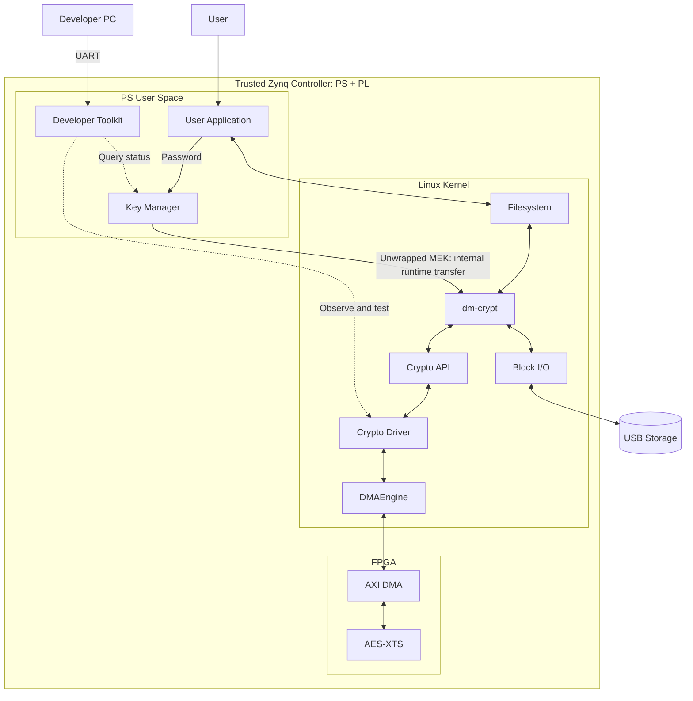
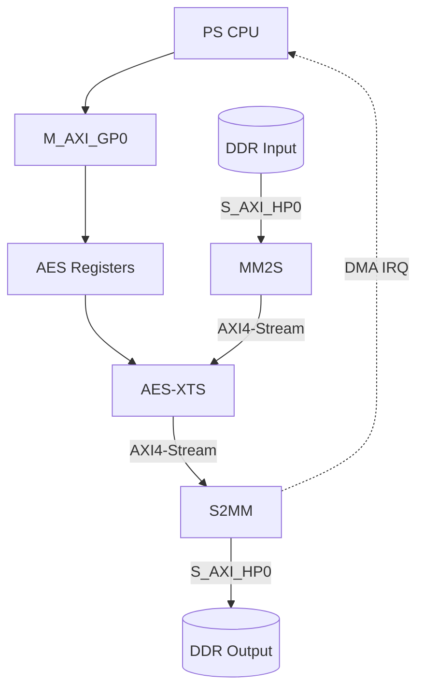
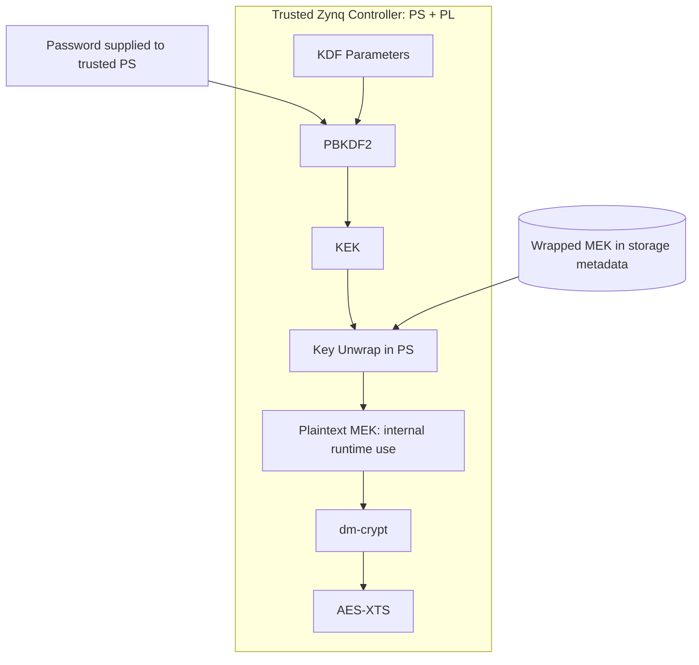
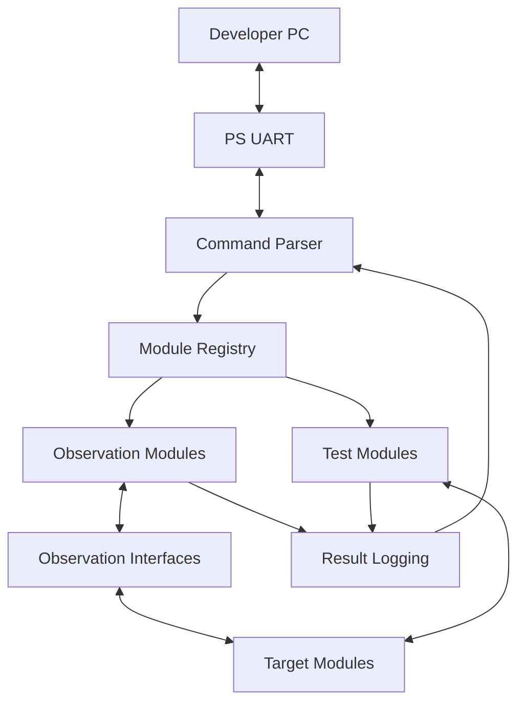

# Zynq SoC-Based Secure Storage System with AES-XTS Hardware Acceleration

> A project to integrate standard Linux storage encryption with an FPGA AES-XTS accelerator and design custom developer verification tools

**Development period: 4 weeks · Team size: 3 · Current status: No implementation or verification items completed**

This project implements an educational subset of a secure storage controller: Linux on the Zynq PS manages keys and storage, the PL accelerates AES-XTS, and a custom UART toolkit helps developers investigate and verify the implementation. The PS and PL together form the trusted controller in this design. The project borrows the external key non-disclosure principle from storage-device specifications; it does not implement a complete SAS/SATA self-encrypting drive or claim OCP, Opal, ISO, or FIPS compliance.

## 1. Project Overview

| Item | Plan |
|---|---|
| Team | Lucky Kernel |
| Objective | Accelerate Linux storage encryption on an FPGA and verify PS–PL integration |
| User features | Encrypt and decrypt files through writes and reads after password entry and volume unlocking |
| Development tools | A UART-based verification toolkit that developers can extend with observation points and test commands |
| Target board | Zybo Z7-20 / Zynq-7000 SoC |
| PS responsibilities | Linux, storage I/O, key management, crypto driver, DMA requests, and diagnostics |
| PL responsibilities | AES-XTS encryption/decryption, AXI4-Lite control, and AXI4-Stream data processing |
| Languages and tools | C, Verilog, Vivado, Embedded Linux, OpenSSL |
| Final integration | Device Tree → Platform Driver → DMAEngine → Crypto API → dm-crypt |
| Target storage | A separate USB storage device is the preferred proposal / exact device and capacity TBD |
| Schedule | Four weeks from kickoff / start and end dates TBD |
| Document status | Pre-implementation plan / design values, responsibilities, and schedule allocations below are proposals |

**Contents**

- [Goals and scope](#2-development-goals-and-scope)
- [Reference requirements and implementation boundary](#24-reference-requirements-and-implementation-boundary)
- [Overall architecture](#3-overall-system-architecture)
- [PS–PL interface](#4-pspl-data-and-control-architecture)
- [Linux driver](#6-linux-software-design)
- [Key management](#7-key-management-design)
- [Developer verification tools](#8-uart-based-developer-verification-toolkit)
- [What constitutes verification evidence](#87-verification-evidence-and-its-limits)
- [Verification and performance](#10-verification-plan)
- [Four-week schedule and three-person responsibilities](#12-four-week-development-schedule)

## 2. Development Goals and Scope

### 2.1 Background

- Target applications: vehicle data loggers, industrial edge devices, and secure storage devices
- Problem: prevent stored data exposure when storage media are lost or removed
- Implementation approach: manage keys and encryption policies on the host/SoC
- Technical challenge: connect the standard Linux crypto/storage frameworks to an FPGA accelerator
- Verification focus: encryption correctness, actual storage and rereading, hardware-path usage, performance, and CPU utilization

### 2.2 Final Development Goals

| Area | Work | Completion criteria |
|---|---|---|
| FPGA | AES-XTS encryption/decryption RTL | Results match the golden model for identical keys, IVs, and inputs |
| PS–PL | MMIO, AXI DMA, IRQ | Verify DDR round-trip transfers, completion notifications, and error recovery |
| Linux | Device Tree, platform/crypto driver | Bind the device and register an `xts(aes)` implementation |
| Storage | Crypto API and dm-crypt integration | Successfully write, read, and reopen files on an encrypted volume |
| Key management | PBKDF2-HMAC-SHA256, KEK/MEK, AES Key Wrap | Restore the key and unlock the volume with the correct password; reject incorrect passwords |
| Development tools | Extensible UART developer toolkit | Demonstrate layer-specific observation, unit tests, and the addition of new verification items |
| Performance | Software/FPGA comparison | Obtain throughput, latency, and CPU utilization measurements under identical conditions |

### 2.3 Phased Scope

| Phase | Scope | Relationship to the final system |
|---|---|---|
| A. Cryptographic verification | OpenSSL golden vectors, AES/XTS RTL simulation | Baseline for computational correctness |
| B. Memory path | DDR → DMA → FPGA → DMA → DDR | Preliminary data-path verification |
| C. File verification | Save FPGA-encrypted output to a USB file, reread it, and decrypt it | Storage round-trip verification before dm-crypt integration |
| D. Standard path | Integrate Crypto API, dm-crypt, and a physical block device | Final storage encryption path |
| E. Operational verification | Key management, diagnostics, performance, and error handling | Final integrated demonstration |

**Extensions**

- Independent 4 KiB encryption units, AES-256-XTS, and performance optimization for multiple requests
- Recovery keys, key backup/rotation/destruction, and cryptographic erase
- Study of TCG Opal and internal SSD security architecture

**Out of scope**

- Implementing NAND controllers, FTL, ECC, or PCIe/NVMe controllers
- Implementing SSD-internal SED features or a TCG Opal-compatible product
- Implementing the LUKS2 format or keyslots
- Full data authentication/tamper detection or product-level security certification

### 2.4 Reference Requirements and Implementation Boundary

The goal is to implement and verify selected storage-encryption and key-lifecycle mechanisms using the existing board, Linux software, and FPGA logic. References guide different parts of the design; they are not interchangeable compliance claims.

| Reference and location | Part adopted in this project | Boundary of implementation |
|---|---|---|
| OCP Datacenter SAS-SATA Device Specification v1.5, section 13.4.7, TCG-LOCKING-4 (page 132) | Design principle that media-key values must not be exposed to the external host | Apply the principle to intended controller interfaces, diagnostics, and persistent storage. The trusted controller includes PS and PL; this does not prove resistance to privileged debugging or satisfy the complete device specification |
| TCG Opal SSC v2.30, sections 2.4 and 4.3.5.5 | Reference model for device-side encryption and internally managed AES keys | Study the separation of access credentials and media keys. Do not implement Opal command protocols, tables, authorities, or a compatible storage device |
| NIST SP 800-38E / XTS-AES | Storage data-unit encryption and interoperability checks | AES-128-XTS initially, 512 B units, fixed IV rules; not authenticated storage or full IEEE 1619 conformance testing |
| NIST SP 800-38F, section 5.2 and Appendix A.2 | AES Key Wrap/Unwrap for MEK storage and the need to protect the KEK | Software key management inside the trusted PS. No hardware-only key custody or non-exportable hardware root key |
| Linux dm-crypt, Crypto API, and DMAEngine documentation | Standard Linux block-encryption, crypto-request, and DMA integration | Retain the normal key-setting path and FPGA offload; do not replace it with a new key-handle protocol or storage stack |
| ISO/IEC 19790 and FIPS 140-3 guidance | Vocabulary for a defined protection boundary and key lifecycle | Design background only. The PS+PL boundary is a project trust assumption, not a validated cryptographic-module boundary |

OCP's requirement concerns the host outside a storage device. Here the PS is part of the trusted controller, not an untrusted external host. The external developer PC is used for trusted development access; the USB device holds ciphertext and wrapped-key metadata. No SAS/SATA target interface to an external storage host is being added. A generic external USB device is not converted into an Opal self-encrypting drive by this project.

**Scope decision:** retain Key Manager, PBKDF2, AES Key Wrap, dm-crypt/Crypto API, FPGA AES-XTS, DMA/IRQ, and the developer toolkit. Clarify ownership, observation rules, and evidence within those tasks. Do not add a secure element, hardware-only key generation/unwrapping, secure persistent key storage, secure boot implementation, or a production UART access-control subsystem. These would require a separate scope decision.

The OCP document also requires a K_AES_256 table (TCG-LOCKING-3); the initial AES-128-XTS implementation is not a claim to meet that requirement. Likewise, implementing selected key-handling principles is not a claim to meet the remaining SAS/SATA, authentication, firmware, physical-security, or certification requirements.

### 2.5 What This Prototype Is Intended to Demonstrate

- A password unlocks wrapped key material within the trusted controller; plaintext MEK is not deliberately exported through application results, UART diagnostics, or persistent storage.
- Linux submits real storage-encryption work to the FPGA, with evidence of both correct results and actual hardware usage.
- Developers can build, use, and extend their own observation/test tool to investigate implementation issues.
- Each result states what was tested and what remains unproven. A successful demonstration is not a claim that a malicious root user, modified kernel, debugger, or physical attacker cannot recover keys.

## 3. Overall System Architecture

### 3.1 Final Storage Integration



**Diagram labels and responsibilities**

The outer controller box is the project's trust boundary. User space, kernel space, and PL are separate execution domains inside it. A MEK crossing those internal domains is not the same as exporting it to an external host. Developer access is trusted and can inspect the system; this diagram does not imply isolation from root or debugging tools.

| Label | Detailed responsibility |
|---|---|
| PS User Space / User Application | Linux user space on the PS / file read/write program |
| Key Manager | Password and MEK management, and volume attachment |
| User / User Application | Password entry and file writes/reads / GUI or CLI to be decided during implementation |
| Developer PC / Developer Toolkit | Developer-only UART command tool / extensible observation points and test commands |
| Linux Kernel | Linux kernel space on the PS |
| dm-crypt | Encrypted block-device layer |
| Crypto API | Request interface for `xts(aes)` encryption/decryption |
| Crypto Driver | FPGA crypto platform driver |
| DMAEngine | DMAEngine API and AXI DMA provider |
| Block I/O | Linux block I/O and USB storage driver |
| AES-XTS | AES-XTS accelerator in the PL |
| USB Storage | USB storage device holding ciphertext |

- **Computation requests:** dm-crypt → Crypto API → FPGA crypto driver → DMAEngine → PL
- **Storage path:** encryption completes → dm-crypt → Block I/O → USB storage
- **Read path:** read USB ciphertext → FPGA decryption through the same path → return plaintext to the filesystem
- **Device Tree:** supplies AES register, IRQ, DMA channel, and clock information to the driver
- **Software baseline:** use a software implementation of the same Crypto API / verify FPGA usage separately

dm-crypt is a block-device encryption layer that uses the kernel Crypto API. Once FPGA computation finishes, the Linux storage stack handles storage I/O. [Linux dm-crypt documentation](https://docs.kernel.org/admin-guide/device-mapper/dm-crypt.html)

### 3.2 Responsibilities by Path

| Path | Source → destination | Responsibility |
|---|---|---|
| Data | PS DDR → AXI DMA → AES-XTS → AXI DMA → PS DDR | Move plaintext and ciphertext |
| Control | CPU → M_AXI_GP0 → AXI4-Lite → AES control registers | Key, IV, mode, length, start, and status |
| Completion | DMA IRQ → DMA provider → crypto driver → Crypto API | Transfer completion, computation status checks, and request completion |
| Key | Password → PBKDF2 → KEK → MEK unwrap → Crypto setkey | Protect stored keys and supply runtime keys |
| Development and verification | Developer PC → UART → toolkit → layer-specific observation/test modules | Query selected status, observe repeatedly, run isolated tests, and extend functionality |

### 3.3 User Features and Developer Tools

| Aspect | User features | Developer verification tools |
|---|---|---|
| Purpose | Password-based storage access and file encryption/decryption | Build internal observation and testing capabilities needed during development |
| Input | Password, target file, and write/read operation | Query target, observation conditions, test data, length, and iteration count |
| Output | Operation success/failure and resulting files | Status, counters, events, measurements, and comparison results |
| When used | When writing or reading files | Module development, bring-up, integration, performance analysis, and fault reproduction |
| Operation | Execute encryption and storage paths for user requests | Run only the required modules, observation points, and tests |

- Investigating a failure after password entry is one example of toolkit usage.
- The toolkit is not restricted to running the entire encryption process in sequence.
- User file operations are implemented as writes and reads after unlocking a dm-crypt volume / an independent per-file encryption format is a separate extension.
- Development goals include both system implementation skills and **the ability to design and extend the necessary development tools**.

## 4. PS–PL Data and Control Architecture



**Diagram labels and interfaces**

| Label | Meaning |
|---|---|
| PS CPU | PS CPU running the crypto driver |
| M_AXI_GP0 | AXI4-Lite control path |
| AES Registers | AES control registers / MODE, KEY, IV, LEN, STATUS |
| DDR Input / DDR Output | Input/output buffers in PS DDR |
| MM2S / S2MM | AXI DMA memory-to-stream / stream-to-memory channels |
| AES-XTS | AES-XTS engine |
| S_AXI_HP0 | AXI DMA access path to PS DDR |
| DMA IRQ | Completion notification through DMAEngine after receiving an IRQ |

### 4.1 Hardware Components

| Block | Role | Design considerations |
|---|---|---|
| Zynq PS | Run Linux and manage DDR and storage | PS configuration, HP/GP ports, and IRQ connections |
| AXI Interconnect | Connect PS–PL addresses and data | Address assignment, data width, clock/reset |
| AXI DMA | Transfer data between DDR and streams | MM2S/S2MM, alignment, maximum transfer length, and SG support configuration |
| AES Core | AES encryption/decryption | Select reusable IP and check its license and supported key lengths |
| XTS Wrapper | Generate tweaks, update them per block, and connect encryption/decryption | Data-unit boundaries, byte order, and key separation |
| AXI4-Lite Slave | CPU control and status access | Register map, START, BUSY, DONE, ERROR |
| AXI4-Stream Wrapper | Connect DMA and AES-XTS | TVALID/TREADY/TLAST, backpressure, and TKEEP usage rules |
| ILA | Observe hardware behavior | Stream handshakes, data length, completion/error signals |

Configure AXI DMA MM2S/S2MM and operating modes according to [AMD PG021](https://docs.amd.com/r/en-US/pg021_axi_dma).

### 4.2 Proposed AES Control Registers

| Item | Purpose | Policy |
|---|---|---|
| ID / VERSION | Identify the IP and its version | Read-only |
| CONTROL | START, encryption/decryption selection, ZEROIZE | Restrict changes while BUSY |
| STATUS | BUSY, DONE, ERROR, KEY_VALID | Specify completion/error clearing rules |
| LENGTH | Request processing length | Validate supported lengths and unit boundaries |
| DATA_UNIT_IV | Encryption-unit identifier | Pass according to Linux IV rules |
| KEY_K1 / KEY_K2 | XTS data key and tweak key | Write-only / never return keys on reads; no key-register diagnostic dump |
| ERROR_CODE | Length, state, and protocol errors | Used for UART and driver diagnostics |

- Register offsets, base address, and IRQ number: fill in after finalizing the Vivado Address Editor and Device Tree.
- Separate ownership of AES key/IV control from DMA control.
- Ongoing DMA register control belongs to the AXI DMA provider driver.
- The crypto driver submits DMA requests through the DMAEngine API.
- Arbitrary DMA register writes from diagnostic tools must not run concurrently with operational I/O.

## 5. Cryptography and Data Formats

| Item | Initial design proposal | Extensions and verification |
|---|---|---|
| AES-XTS mode | AES-128-XTS | Add AES-256-XTS after reviewing RTL resources and schedule |
| MEK composition | K1: 128 bits + K2: 128 bits = 256 bits total | 512 bits total for AES-256-XTS |
| AES block | 16 B | Verify block order and endianness |
| Encryption data unit | 512 B | Independent 4 KiB units are a separate extension |
| 4 KiB request | Split into eight 512 B data units | Reinitialize the IV/tweak for each unit |
| IV scheme | Match dm-crypt `aes-xts-plain64` | Fix sector numbering, IV offset, and byte order |
| Initial input range | Integer multiples of 512 B | Arbitrary lengths and CTS are outside the basic demonstration scope |
| Verification baseline | Identical K1/K2, IV, data unit, and input → identical ciphertext | Cross-check software, RTL, and physical hardware |

- **Terminology:** DEK in the previous README serves the same data-encryption-key role as MEK in this document.
- **Key lengths:** distinguish the total AES-XTS key length from each individual AES key length. [OpenSSL AES documentation](https://docs.openssl.org/3.5/man3/EVP_aes_128_gcm/)
- **IV boundaries:** define IVs using the encryption-unit number used by dm-crypt; do not mix simple file offsets with physical USB LBAs.
- **4 KiB extension:** separately verify IV differences caused by `sector_size` and `iv_large_sectors`. [dm-crypt IV rules](https://docs.kernel.org/admin-guide/device-mapper/dm-crypt.html)
- **Protection scope:** XTS provides stored-data confidentiality / data authentication and tamper detection require separate design. [NIST SP 800-38E](https://csrc.nist.gov/pubs/sp/800/38/e/final)

## 6. Linux Software Design

### 6.1 Module Responsibilities

| Module | Implementation | Deliverable |
|---|---|---|
| Device Tree | compatible, reg, clocks, interrupts, dmas, dma-names | DTS/DTSI or overlay |
| Platform Driver | probe/remove, acquire MMIO resources, initialize and clean up the device | Kernel module |
| DMA Client | Request channels, prepare/map buffers, transfer, complete, and abort | DMA loopback and encryption transfer code |
| Crypto Driver | Register skcipher, setkey, encrypt/decrypt, asynchronous completion | `xts(aes)` provider |
| Key Manager | Generate MEK, wrap/unwrap, change passwords, and lock | User-space C tool |
| Volume Manager | Create, remove, and reopen dm-crypt mappings | Execution tools and configuration files |
| Developer Toolkit | Parse commands, register modules, configure observations, run isolated tests, and record results | Extensible UART CLI and observation/test modules |
| Test/Benchmark | Golden comparisons, file/block verification, and performance measurements | Tests, CSV files, and measurement records |

### 6.2 Cryptographic Request Processing

1. Inspect the input/output scatterlists, length, and IV in the Crypto API request.
2. Validate the key context, data-unit boundaries, and device state.
3. Prepare driver-owned transfer buffers or appropriate DMA mappings.
4. Configure the AES mode, key, IV, and length through MMIO.
5. Prepare S2MM reception, then start the MM2S input transfer.
6. Check the DMA completion callback and AES status.
7. Confirm TX/RX termination, perform required synchronization and result copying, and release resources.
8. Notify the Crypto API of request completion / return an error on failure.

**Implementation principles**

- Initial priority: serialized requests, bounded buffers, and clear error recovery.
- Handle noncontiguous scatterlist memory and data-unit splitting.
- Distinguish DMA addresses from CPU virtual addresses / use mappings appropriate to the actual DMA device.
- Do not reuse or release buffers before transfer completion.
- On timeout/reset, terminate DMA before cleaning up resources and completing in-flight requests.
- Avoid long waits and blocking operations in IRQ handlers/callbacks.
- Store keys per cipher context, serialize hardware access, and clean up keys when replacing or removing them.
- Restrict direct DMA register experiments to initial bring-up / do not control DMA concurrently with DMAEngine.

References: [DMAEngine Client API](https://docs.kernel.org/driver-api/dmaengine/client.html), [skcipher API](https://docs.kernel.org/crypto/api-skcipher.html)

### 6.3 Confirming Actual FPGA-Path Usage

- Register the generic `xts(aes)` name and a unique driver name.
- Check the driver name and priority in `/proc/crypto`.
- Instrument FPGA driver request counts, processed bytes, and IRQ/DMA completions.
- Confirm FPGA counter increases before and after actual dm-crypt file I/O.
- For software comparisons, exclude the FPGA provider or explicitly select a software provider.
- Record whether automatic software fallback was used after a hardware failure.

Algorithm registration alone does not prove that dm-crypt uses the FPGA; verify actual request counters as well. [Kernel Crypto API selection rules](https://kernel.org/doc/html/latest/crypto/architecture.html)

## 7. Key Management Design

### 7.1 Key Hierarchy

**Stored key versus runtime key:** USB metadata contains the wrapped MEK. Unlocking reconstructs the plaintext MEK in trusted PS memory and supplies it through dm-crypt/Crypto API to PL key registers. AES-XTS uses the actual key, not the wrapped blob. The Key Manager handles generation, derivation, wrapping, and password changes; dm-crypt uses the supplied key for block encryption. They have different responsibilities.

Because the PS can hold both the KEK and wrapped MEK, this design does not hide the MEK from PS software. Moving only Unwrap to the PL would not change that fact. Clearing temporary software copies and providing PL zeroization reduce key lifetime; they do not establish immunity to RAM extraction or prove complete physical erasure.



**Diagram labels and key hierarchy**

| Label | Meaning |
|---|---|
| Password | User password |
| KDF Parameters | Salt and iteration count |
| PBKDF2 | PBKDF2-HMAC-SHA256 |
| KEK | Key Encryption Key / protects the MEK |
| Wrapped MEK | Stored encrypted MEK |
| Key Unwrap | AES Key Unwrap |
| MEK | Data encryption key / XTS K1 + K2 |
| dm-crypt | Supplies the MEK through the Crypto API setkey path |
| AES-XTS | FPGA AES-XTS engine |

### 7.2 Creation, Unlocking, and Locking

| Stage | Processing | Storage and cleanup policy |
|---|---|---|
| Initial creation | Generate the MEK and salt using cryptographically secure randomness | Do not derive the MEK directly from the password |
| KEK derivation | Password + salt + iteration count → PBKDF2-HMAC-SHA256 | Finalize the iteration count after measuring unlock time on the board |
| Key storage | Wrap the MEK with the KEK using AES Key Wrap | Never persist the password, plaintext KEK, or plaintext MEK |
| Volume unlocking | Same KDF → unwrap MEK → supply to dm-crypt | Do not create a mapping if unwrap fails |
| Password change | Rewrap the same MEK with a new KEK | Distinct from re-encrypting all data |
| Locking | Finish I/O → unmount → remove mapping → clean up keys | Include driver contexts and PL key state |
| MEK change | Re-encrypt data with a new MEK | Distinct from KEK replacement / extension |

- Proposed KEK length: 256 bits / AES-256 Key Wrap.
- Password entry: disable terminal echo / do not pass keys through command-line arguments or logs.
- Key Manager → dm-crypt: consider libcryptsetup or controlled memory/file-descriptor transfer.
- Key management runs in user space / data encryption/decryption runs in the PL.
- AES Key Wrap protects keys and is not an authentication feature for XTS-encrypted data.

References: [OpenSSL PBKDF2](https://docs.openssl.org/3.5/man7/EVP_KDF-PBKDF2/), [NIST Key Wrapping](https://csrc.nist.gov/pubs/sp/800/38/f/final)

### 7.3 Proposed Stored Metadata

| Category | Fields |
|---|---|
| Format | Magic, Format Version, Volume UUID |
| Cryptography | Cipher, MEK Length, Wrap Algorithm |
| KDF | Hash, Salt, Iteration Count |
| Storage area | Payload Offset, Data Unit Size, IV Mode, IV Offset |
| Protected key | Wrapped MEK |
| Validity | Length, range, and supported-version checks / finalize tamper-checking methods before implementation |

- Proposed setup: custom educational key metadata + a plain dm-crypt mapping.
- Finalize the key metadata file, storage location, and backup method in Week 1.
- Separate storage areas so normal volume creation cannot overwrite key metadata.
- Do not describe a custom AES Key Wrap format as equivalent to a LUKS2 keyslot.
- Initially verify the PBKDF2/KEK/MEK lifecycle, AES Key Wrap behavior, and dm-crypt integration; no LUKS2-compatible metadata format is implemented.

### 7.4 Recovery and Key Lifecycle Extensions

| Situation | Response direction | Scope |
|---|---|---|
| Forgotten password | Recovery slot protecting the same MEK with a separate recovery KEK | Extension |
| Controller/FPGA replacement | Software decryption using the same MEK, IV rules, and metadata | Design and vector verification |
| Corrupted key metadata | Back up and restore the wrapped MEK and required metadata | Method design / implementation subject to schedule review |
| Power loss | Verify metadata update atomicity and consistency | Basic error review |
| Recovery key exposure | Separate storage, access permissions, and operational procedures | Extension design |
| Loss of all keys | Recovery is impossible without a valid MEK or recovery mechanism | State this limitation |
| Cryptographic erase | Define destruction scope for keys, wrapped copies, backups, and memory remnants | Extension / do not overstate erasure effectiveness |

**Protection assumptions**

- The main demonstration scenario is removal and inspection of locked storage media.
- Assume a trusted Linux kernel, root user, and FPGA bitstream.
- Root compromise, runtime RAM extraction, physical side channels, and secure-boot bypass are separate issues.
- Keys are supplied from the PS to the PL; do not describe this as a hardware root of trust implementation.
- The developer PC, development shell, and debugging tools are trusted during development. No claim is made that a developer with root or debugger access cannot extract a runtime key. Avoiding key output in toolkit commands is an interface policy, not enforcement against a compromised PS.

## 8. UART-Based Developer Verification Toolkit

### 8.1 Purpose

**Why build this tool?** The team wants experience creating the tools needed to develop the system, not just using existing utilities or printing progress messages. When a transfer hangs, ciphertext differs, or a request fails, the developer should be able to choose an observation point, run a focused test, collect evidence, and add a new handler if the current tool cannot answer the question.

**Why UART?** It provides a simple serial command/result connection from the developer PC to the board's Linux terminal without requiring a network service or graphical interface. UART is the transport; the parser, module registry, observation hooks, test handlers, comparisons, and records are the tool we implement. UART is not the encryption data path, a source of trustworthy results by itself, or a product authentication interface. It cannot diagnose a stopped kernel by itself; RTL simulation and ILA remain complementary tools.

**Intended use:** select a development question → choose or add a command → execute a controlled test or collect observations → compare with an expected result → inspect failures → repeat after a fix. No mandatory password-to-file workflow or fixed command sequence is imposed.

- Design custom internal observation and testing tools suited to the system.
- Allow developers to select the required layers, values, events, and conditions.
- Query module status, run independent tests, observe repeatedly, and save results.
- Add observation points and test commands as new needs arise during development.
- Treat **observation-point design, tool extensibility, and verification evidence** as the core outcomes, rather than learning a fixed command list.

**Basic access path:** Developer PC ↔ PS UART ↔ Linux terminal ↔ C developer toolkit

Keep this development access model, including a shell and ILA when needed. Building a separate locked-down production UART mode is not part of the four-week scope. Development/debug access must not be presented as a hostile-host security demonstration.

For detailed cryptographic debugging, use known test keys with no confidential data behind them. "Public test key" means a deliberately known symmetric test value, not a public key from asymmetric cryptography. Such test values may be inspected to locate errors. MEKs/KEKs used to protect user files must not be printed in diagnostic logs or connected to key-bearing ILA probes. This is a test-data and observation policy, not an additional key-management feature.

### 8.2 Internal Structure



| Component | Design |
|---|---|
| Command parser | Parse targets, commands, and options; validate input; provide help |
| Module registry | Register module names, command tables, and handlers / extend through C functions |
| Observation modules | Status snapshots, selected event traces, counters, and timing measurements |
| Test modules | Known vectors, loopback, repeated tests under selected conditions, and expected-value comparisons |
| Observation interfaces | User software hooks, driver status/event buffers, MMIO status, and PL counters |
| Result logging | Record timestamps, request identifiers, items, values, results, and errors; output text/CSV |

### 8.3 Example Observation and Verification Targets

| Target | Information and tests developers can select |
|---|---|
| User software | Selected operation, processing length, start/end, and returned errors |
| Key Manager | KDF/unwrap success, elapsed time, and key readiness |
| Crypto API/Driver | Selected provider, request acceptance/completion, queue, and error stage |
| MMIO | IP ID/version and permitted control/status registers |
| DMA | Requested/completed bytes, channel status, callbacks, and timeouts |
| AES-XTS | Busy/Done/Error, test-vector matches, and input/output block counts |
| IRQ | Occurrence, handling, and request-completion counters; timestamps and latency |
| Storage | Mapping state, read/write results, and original/decrypted data comparisons |

- These are example observation points / the tool need not always output every item.
- Add new items by extending both the target module's hooks/counters/status interface and the tool handler.
- Design exposed status registers/counters for internal PL signals, and use ILA for detailed timing.
- UART carries toolkit commands and results / it is not a required path for file data or encryption computation.

### 8.4 Example Commands and Uses

| Example command | Purpose |
|---|---|
| `help` | List registered modules, commands, and options |
| `show driver` | Query driver, queue, key readiness, and last error |
| `show mmio` | Inspect permitted register snapshots |
| `watch irq` | Repeatedly observe IRQ counters and timestamp changes |
| `trace dma irq` | Collect only the required events |
| `test dma` | Transfer known patterns without user file operations |
| `test xts` | Compare against golden results using public test keys, IVs, and inputs |
| `crypto-stat` | Check provider, hardware requests, and processed bytes |
| `selftest` | Run a developer-selected group of tests |
| `recover` | Perform controlled reinitialization and verify recovery of normal requests |

- Commands and options are design examples / finalize them in module command tables during implementation.
- Expose test length, iteration count, observation interval, and event type as options when needed.
- Run partial functions independently, such as DMA-only verification, register inspection, and IRQ observation.
- Keep password-to-file failure analysis as one of several usage scenarios.

### 8.5 Observation and Test Interfaces

- User software: hooks and result records for status, errors, and timing.
- Kernel: restricted status-query interfaces and bounded event buffers.
- Test requests: use controlled test interfaces provided by the driver.
- UART output: focus on snapshots and collected results / buffer high-frequency events before querying them.
- Correlation: link user operation IDs to driver subrequest IDs when needed / do not assume a one-to-one relationship.
- Measurement impact: record trace/output settings and buffer overflow counts with results.
- Operational conflicts: share the driver's state and locking / block resets and dangerous tests during I/O.
- Secrets: ordinary diagnostics observe status, lengths, and counters, not actual passwords, KEKs, MEKs, key schedules, or user plaintext. Explicit tests may inspect known test values; they must not reuse user-data keys.
- Observation limits: usable while Linux/the driver can execute / supplement kernel hangs and detailed PL signals with separate logs and ILA.

### 8.6 Evidence of Tool Development Skills

| Evidence | What to present |
|---|---|
| Design | What needed verification and the required hooks, commands, and result formats |
| Implementation | Parser, registry, handlers, and target-module observation interfaces |
| Usage | Query selected internal states or narrow down a cause through isolated tests |
| Extension | Add observation points and test commands for needs discovered during development |
| Verification | Compare values, events, and test results before/after fixes, with reproduction steps |

**Proposed completion criteria:** shared toolkit structure + selected observation/test modules + an example of adding a verification item + reproducible result records

### 8.7 Verification Evidence and Its Limits

A message such as "key configured" or "encryption complete" is only a log unless it is backed by a defined check. The toolkit must distinguish command submission, observed completion, and a test verdict. A hardware status bit is useful evidence but is not an independent proof that the hardware implements the intended operation.

| Question | Evidence to collect using the planned implementation | What this does not establish |
|---|---|---|
| Was an MEK generated? | Check cryptographic RNG API result and required output length; stop on failure | A success return or different samples do not prove entropy quality |
| Was the intended key configured? | Load a known test key and compare a real AES-XTS operation with an independently computed OpenSSL result | KEY_VALID alone does not prove correct key loading; do not export a user MEK to perform this check |
| Is encryption correct? | Compare FPGA output byte-for-byte with golden output for fixed keys, IVs, lengths, and data-unit boundaries; record mismatch counts | Round-trip success alone can hide matching encryption/decryption bugs; finite vectors do not prove all inputs correct |
| Did DMA and the FPGA actually run? | Correlate transfer lengths, completion/error events, hardware request counters, and output comparisons | An application success message or provider registration alone does not prove FPGA usage |
| Was a key cleared? | Inspect key and expanded-key clearing in RTL simulation; on hardware, request ZEROIZE, check invalid state, verify rejection before rekeying, then verify successful rekeying | Request rejection proves use is blocked, not that every physical key remnant is gone; PS memory copies need separate cleanup review |
| Does recovery work? | Trigger a controlled timeout/error, check termination and cleanup, then run a valid request and compare its result | A printed "recovered" message is not evidence that the next request works |

Illustrative result format only; these are not measured project results:

```text
Test: XTS known-vector comparison
Vector ID: xts-512-sector-0
Length: 512 bytes
Reference: OpenSSL golden output
Mismatched bytes: 0
Verdict: PASS for this vector

Test: key-use blocking after ZEROIZE
Operation before ZEROIZE: completed
Observed KEY_VALID after ZEROIZE: 0
Operation without rekeying: rejected
Verdict: PASS for post-zeroize use blocking
Physical key erasure: not established by this test
```

Records should identify the test, expected and observed result, comparison rule, and relevant build/environment. Missing evidence or an unexecuted check must be reported as not tested/inconclusive, not PASS. Use the already planned RTL testbench, OpenSSL golden model, driver instrumentation, and text/CSV logging; this does not introduce another verification subsystem.

## 9. Main Operating Scenarios

### 9.1 Storage Writes

1. Enter password → derive KEK → unwrap MEK.
2. Create dm-crypt mapping → mount filesystem.
3. Write user file → dm-crypt encryption request.
4. Crypto driver prepares the key, IV, and DMA transfer.
5. PL AES-XTS encrypts → returns results to DDR.
6. Complete request → Linux block I/O → store ciphertext on USB.

### 9.2 Reads and Reopening

1. Read USB ciphertext → dm-crypt decryption request.
2. FPGA decrypts using the same MEK, data unit, and IV.
3. Return plaintext to the filesystem → compare hashes and bytes with the original.
4. Unmount and remove mapping → clear key state.
5. Reboot and verify reopening with the same password and metadata.

### 9.3 Incorrect Passwords and Communication Failures

- Incorrect password: unwrap fails → abort mapping creation.
- DMA timeout: terminate transfer → clean up buffers → return request failure → record diagnostics.
- AES error: inspect ERROR_CODE → prevent result use → reinitialize if needed.
- Device removal: block new requests → terminate in-flight requests → clean up keys and resources.
- Recovery verification: confirm that the next valid request succeeds after fault handling.

### 9.4 Toolkit Usage Examples

- Module development: run a DMA-only test over UART → inspect transfer/completion status.
- Integration analysis: select required crypto/DMA/IRQ events → compare request progress points.
- Performance analysis: observe processing time, copying, and DMA costs by data length.
- Extension: add an observation hook and command handler → inspect results in the toolkit.
- User-operation analysis: query only relevant items when password or file operations fail.
- These are usage examples / they do not impose a fixed execution order or mandatory diagnostic procedure.

## 10. Verification Plan

| ID | Target | Input and method | Pass criteria |
|---|---|---|---|
| T01 | Golden model | OpenSSL EVP-based C tool and fixed keys/IVs/inputs | Reproducible vectors and result files |
| T02 | AES RTL | Encryption/decryption known vectors | Bit-exact match with expected results |
| T03 | XTS RTL | 512 B, LBA 0/1, consecutive units | Ciphertext and decrypted data match the golden model |
| T04 | DMA loopback | Known patterns and different lengths | Input equals output, completion notification, no timeout |
| T05 | FPGA crypto | DDR → DMA → AES-XTS → DDR | Bit-exact match with software / successful round trip |
| T06 | Kernel crypto | setkey, encrypt/decrypt, multiple contexts | No key/IV mix-ups / correct asynchronous completion |
| T07 | Actual acceleration usage | dm-crypt I/O + hardware counters | Driver request, processed-byte, and DMA completion counters increase |
| T08 | Preliminary file verification | Save ciphertext file → reread → decrypt | Bytes and hash match the original |
| T09 | dm-crypt volume | Create, read, synchronize, and reopen files | Original data matches / cross-decryption with software implementation |
| T10 | Key management | Correct/incorrect passwords and password changes | Successful unlock / incorrect password rejection / reopen after change |
| T11 | Exception handling | Invalid lengths, timeout, reset | Resource cleanup, error return, and subsequent valid request succeeds |
| T12 | Performance | Repeated software/hardware measurements under identical conditions | Record raw results, environment, and measurement boundaries |
| T13 | Developer toolkit | Observe selected modules, run isolated tests, and register new handlers | Existing items work; new-item results can be queried and recorded |
| T14 | Observation reliability | Trace on/off, buffer saturation, concurrent operational I/O | Indicate measurement impact and dropped events; prevent test conflicts |

Apply section 8.7 when interpreting all PASS results. Within T06/T10/T11, include known-key operation checks and key-clear/use-blocking checks; retain RTL evidence separately from hardware status logs. Within T13, demonstrate one failed comparison or unmet condition as well as a passing result so that unconditional success printing cannot satisfy the toolkit completion criterion.

**Additional checks**

- Compare a 4 KiB request as eight 512 B units / do not confuse it with one 4 KiB XTS unit.
- Confirm different ciphertext for different data-unit numbers with the same plaintext and key.
- Check vendor/IP dependence through FPGA ↔ software cross-decryption.
- Do not judge encryption correctness or security solely by searching storage media for plaintext strings.
- Separate experimental storage from the active root/boot medium.
- Include the runtime environment, kernel configuration, bitstream, source commit, key length, and IV rules in verification records.

## 11. Performance Measurement Plan

### 11.1 Measurement Boundaries

| Category | Measurement range | Comparison purpose |
|---|---|---|
| RTL core | AES-XTS input acceptance → output completion | Cycles and core throughput |
| Crypto request | Driver request acceptance → completion callback | Hardware offload costs including copying, DMA, and IRQ |
| Storage I/O | File/block I/O start → synchronized completion | Impact on the actual storage path |

### 11.2 Conditions and Metrics

- Use the same board, CPU conditions, cipher, key length, data unit, and I/O sizes.
- Prefer the same kernel crypto path for software comparisons / label standalone OpenSSL measurements separately.
- Repeat measurements after warm-up / record iteration count, input size, and concurrent request count.
- Distinguish buffered/direct I/O, cache effects, and whether `fsync` is included.
- Separately analyze DMA setup, copying, and IRQ costs for small requests, and storage bottlenecks.
- The goal is to measure acceleration and bottlenecks / do not claim speedup figures before measurement.

| Metric | Unit | Record |
|---|---|---|
| Throughput | MiB/s | Encryption/decryption, software/hardware |
| Latency | us or ms | Mean, distribution, and tail latency |
| CPU usage | CPU time, CPU utilization | Measurement tool and interval |
| FPGA resources | LUT, FF, BRAM, DSP | Synthesis and implementation reports |
| Clock/timing | MHz, WNS, Fmax | Applied clock, timing closure, and maximum operating frequency assessment |
| Reliability | Counts | Errors, timeouts, retries, and successful recoveries |

**Current measurements: none / add result tables, raw CSV files, and analysis after measurement**

## 12. Four-Week Development Schedule

| Week | Linux/Driver | FPGA/RTL | Key, verification, and integration | Weekly completion criteria |
|---|---|---|---|---|
| 1 | Linux boot, DT/MMIO, software dm-crypt baseline | AES IP selection, AES/XTS testbenches, basic AXI/DMA design | Golden model, key format, toolkit parser/registry, observation specifications | Environment, golden model, software volume, and tool extension structure |
| 2 | DMAEngine loopback, IRQ, observation hooks, crypto driver skeleton | XTS encryption/decryption, stream, registers, observation counters | Key wrap/unwrap, file verification, observation/test modules | DMA round trip, FPGA/golden match, and isolated-test tools |
| 3 | skcipher, dm-crypt, request-event integration | Hardware errors, reset, timing, ILA debugging | Password → MEK → mapping, selected observations, new commands | Actual hardware file I/O, key unlocking, and a toolkit extension example |
| 4 | Timeout, concurrency, removal handling, integration fixes | Functional stabilization and resource/timing reports | Reopening, exceptions, performance, tool usage evidence, presentation | Integration, reproduction materials, and tool development/usage demonstration |

**Schedule management**

- Verify software dm-crypt and the Key Manager in Week 1 to separate their dependencies from FPGA integration.
- Establish a repeatable minimal hardware encryption/decryption round trip in Week 2.
- Prioritize end-to-end integration in Week 3; optimize afterward.
- If a gate is not passed, state the incomplete scope / do not label an earlier phase's success as final dm-crypt completion.
- Defer performance optimization, independent 4 KiB units, and recovery extensions until basic integration is complete.

## 13. Proposed Three-Person Responsibilities

| Owner | Primary responsibilities | Joint integration and verification | Key deliverables |
|---|---|---|---|
| A — Linux/Driver | Device Tree, platform driver, DMAEngine, Crypto API, IRQ/timeout | Agree on registers/streams with B; connect dm-crypt with C | DTS, kernel module, driver test results |
| B — FPGA/RTL | AES-XTS RTL, AXI4-Lite/Stream, DMA block design, clock/reset | PS–PL integration with A; golden comparisons with C | RTL, testbenches, bitstream, resource/timing reports |
| C — Key/Test/Tool | Golden model, Key Manager, volume tools, UART toolkit, benchmark | Observation points, test interfaces, key supply, and vectors with A/B | Extensible developer tools, automated verification, CSV files, integrated demonstration |

- Named assignments: TBD.
- Each owner is responsible for code, specifications, individual verification, and integration fixes.
- Whole-team reviews: request format, key/IV rules, error codes, and gate results.
- C leads toolkit common components and command handlers / A provides driver hooks; B provides PL status and counters.

## 14. Completion Gates and Current Status

| Gate | Completion criteria | Required evidence | Current status |
|---|---|---|---|
| G0 | Finalize board, OS, tools, and cipher/IV rules | Environment specification and boot logs | Incomplete |
| G1 | Software golden model and key-management unit verification | Vectors and wrap/unwrap results | Incomplete |
| G2 | AES-XTS RTL correctness | Testbenches, waveforms, comparison results | Incomplete |
| G3 | Linux DMA loopback and IRQ | Transfer, completion, and comparison logs | Incomplete |
| G4 | FPGA memory encryption/decryption and file round trip | Golden matches, hashes, original-data comparisons | Incomplete |
| G5 | Actual hardware path through Crypto API and dm-crypt | Provider, hardware counters, I/O results | Incomplete |
| G6 | Unlock, reopen, recover, toolkit observation/testing, and new-item extensions | PASS/FAIL, code before/after extension, UART results | Incomplete |
| G7 | Software/hardware performance, resources, integrated demonstration | CSV files, reports, reproduction steps, video | Incomplete |

## 15. Main Risks and Responses

| Risk | Impact | Response |
|---|---|---|
| RTL development/decryption delays | FPGA integration delays | Consider reusing verified AES IP and fix initial vectors early |
| Crypto API/dm-crypt integration difficulty | File storage works but the standard path remains incomplete | Week 1 software baseline and parallel Week 2 driver skeleton |
| IV/unit/endianness mismatch | Compatibility fails despite some successful round trips | Vector specifications and software/hardware cross-decryption |
| DMA/TLAST/cache issues | Hangs and data corruption | Isolated loopback, ILA, timeouts, mapping verification |
| Software provider used unintentionally | Incorrect performance conclusions | Verify hardware request counters and provider |
| Unclear key/metadata format | Reopening/recovery failures | Fix the format in Week 1; test password changes and rebooting |
| USB/copying bottlenecks | Lower-than-expected speedup | Separate core, crypto, and system measurement boundaries |
| Excessive scope within four weeks | Insufficient time to stabilize basic features | Prioritize basic integration, diagnostics, and measurement; keep recovery and similar features as extensions |

## 16. Expected Deliverables and Demonstrations

### 16.1 Deliverables

- [ ] Overall architecture, register map, and key/IV specifications
- [ ] Vivado block design, RTL, testbenches, and bitstream
- [ ] Device Tree, kernel configuration, and crypto driver
- [ ] OpenSSL golden model, vectors, and automated comparison tools
- [ ] Key Manager, volume tools, and extensible UART developer toolkit
- [ ] Toolkit command registration structure, observation hooks, test modules, and new-item extension examples
- [ ] File, block, key, error, and reboot verification records
- [ ] Software/hardware performance CSV files and FPGA resource/timing reports
- [ ] Installation, build, execution, and recovery procedures, plus a final demonstration video

### 16.2 Example User-Feature Demonstration

1. Boot the board → check driver/FPGA status and confirm no key is configured.
2. Enter password → unwrap MEK → unlock encrypted volume.
3. Write a file → check FPGA request and DMA completion counters.
4. Read the file → confirm hashes and bytes match the original.
5. Remove mapping → reject an incorrect password → reopen with the correct password.
6. Select required observation/test commands → check timeout/error handling and successful recovery.
7. Compare software/hardware throughput, latency, CPU usage, and FPGA resources.

### 16.3 Example Tool Development and Usage Demonstration

1. Present the development issue to investigate and the required internal information.
2. Select observations or run unit tests over UART.
3. Use status, events, and measurements to narrow down the problem.
4. Add the newly required hooks and command handlers.
5. Show the new command's results and compare tests before/after the change.

- Present the toolkit's structure, extensibility, and evidence of use separately from user encryption features.
- Select demonstration targets and order according to actual development issues.

## 17. Decisions Required at Kickoff

| Item | Current value or decision criteria |
|---|---|
| Kernel, distribution, Vivado, and OpenSSL versions | Fix after checking board/IP/driver compatibility |
| Board, USB, and UART equipment | Availability and costs TBD |
| AES IP, license, and supported ciphers | Confirm reuse options and functionality |
| Hardware addresses, IRQs, clocks, and DMA settings | Finalize together with block design and Device Tree |
| Key metadata, transfer, and recovery methods | Agree on the educational format, permissions, and lifecycle |
| Numerical performance targets | Set after measuring the software baseline |
| Toolkit observation and test items | Start with modules needed for bring-up / add more during development |
| Named responsibilities and calendar dates | Assign three people and finalize the kickoff date |

## 18. References

**Input materials**

**Official technical documentation**

- [OCP Datacenter SAS-SATA Device Specification v1.5](https://www.opencompute.org/documents/datacenter-sas-sata-device-specification-1-5-2025-06-27-pdf): section 13.4.7, TCG-LOCKING-3/4; selected design reference, not a compliance target.
- [TCG Opal SSC v2.30](https://medias.cdn.trustedcomputinggroup.org/production/TCG_Storage_Opal_SSC_v2_30_pub_f4e29a2c4b.pdf): sections 2.4 and 4.3.5.5; storage-device architecture reference.
- [ISO/IEC 19790:2025](https://www.iso.org/standard/82423.html) and [ISO/IEC 24759:2025](https://www.iso.org/standard/82424.html): official catalogs for module requirements and testing; full ISO texts were not obtained.
- [FIPS 140-3 implementation guidance](https://csrc.nist.gov/csrc/media/Projects/cryptographic-module-validation-program/documents/fips%20140-3/FIPS%20140-3%20IG.pdf): IG 9.5.A/9.6.A in the downloaded 2026-08-19 edition explain key entry/output and storage using ISO/IEC 19790:2012. Do not treat those clause references as verified text of the 2025 ISO edition.
- [Downloaded standards and reading guide](implementation-guides/security-standards/READING-GUIDE.md): local original PDFs, relevant pages, edition distinctions, and source URLs.

- [AMD AXI DMA PG021](https://docs.amd.com/r/en-US/pg021_axi_dma)
- [Linux DMAEngine Client API](https://docs.kernel.org/driver-api/dmaengine/client.html)
- [Linux Kernel Crypto API Architecture](https://kernel.org/doc/html/latest/crypto/architecture.html)
- [Linux skcipher API](https://docs.kernel.org/crypto/api-skcipher.html)
- [Linux dm-crypt](https://docs.kernel.org/admin-guide/device-mapper/dm-crypt.html)
- [OpenSSL AES/XTS](https://docs.openssl.org/3.5/man3/EVP_aes_128_gcm/)
- [OpenSSL PBKDF2](https://docs.openssl.org/3.5/man7/EVP_KDF-PBKDF2/)
- [NIST SP 800-38E — XTS-AES](https://csrc.nist.gov/pubs/sp/800/38/e/final)
- [NIST SP 800-38F — Key Wrapping](https://csrc.nist.gov/pubs/sp/800/38/f/final)

**Open-source candidates to review**

- [secworks/aes](https://github.com/secworks/aes): AES core candidate / adopt after reviewing supported modes, key lengths, and license.
- [Xilinx/axi-packaging-and-linux-driver](https://github.com/Xilinx/axi-packaging-and-linux-driver): candidate reference for custom IP/Linux integration.
- AES-XTS and AXI DMA candidates listed only by name in the previous README: add after confirming exact repositories, supported features, and licenses.

> The architecture, schedule, interfaces, and diagnostic commands in this document are implementation plans. Update completed items only after checking evidence for each gate.
